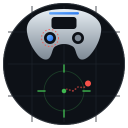
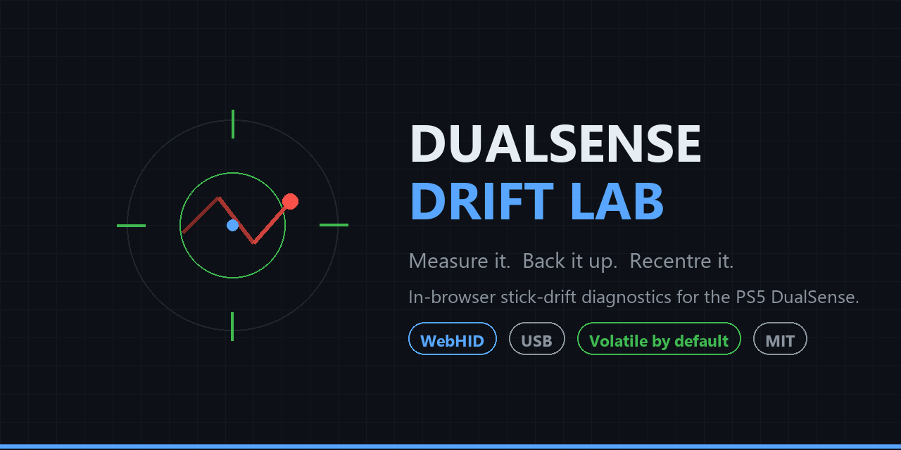

<p align="center">
  
</p>

<h1 align="center">DualSense Drift Lab</h1>

<p align="center">
  <b>Measure it. Back it up. Recentre it.</b><br>
  In-browser stick-drift diagnostics and calibration for the Sony DualSense &amp; DualSense Edge.
</p>

<p align="center">
  <a href="https://alshkylybdalslam.github.io/dualsense-drift-lab/"><b>Launch the tool &rarr;</b></a>
</p>

<p align="center">
  
  
  
  
  
</p>

<p align="center">
  
</p>

---

## Why this exists

Stick drift is a worn potentiometer. The **real** fix is replacing the stick module — a ~$5 part, a T6 and T8
driver, and about twenty minutes. Nothing in software changes that physical fact.

But replacement costs time and money, and sometimes you just want the controller playable tonight. And if you
play on a **PS5**, there is a hard constraint: no software running on your PC can reach the console. DS4Windows,
Steam Input, reWASD — none of them touch what the PS5 sees. They all sit on the PC side of the cable.

The one place a fix *does* survive the trip to the console is **inside the controller itself**. DualSense
calibration is stored on the pad. Recentre the sticks there and the correction applies everywhere the controller
goes: PC, PS5, another PC, a friend's house.

The trade-off is that recentring doesn't repair the wear. It shifts the reported centre *around* the wear, which
steals throw from the drifting direction. Done carelessly that makes things worse with no way back.

**This tool exists to make that trade-off safe, visible, and reversible.** That's the whole design brief.

---

## The safety model

This is what separates Drift Lab from the other calibration utilities, so it comes before the feature list.

### Writes are volatile by default

The default write goes to controller **RAM**, not flash. It survives until the controller loses power.

> **Unplug the controller and the original calibration comes back.**

Try it. If the stick feels worse, unplug. Nothing to undo, because nothing permanent happened. This turns a
nervous, irreversible gamble into something you can just experiment with.

### Permanent is a separate, deliberate act

Getting to flash (NVS) requires clearing three deliberate gates:

1. Ticking **"make permanent"**, which is off by default
2. Typing the word `PERMANENT` into a confirmation field
3. An explicit `0x80` unlock → write → relock sequence

The UI labels it plainly as the irreversible one, and the confirmation text changes after a permanent write to
say so. There is no subtle path to flash.

### Nothing happens invisibly

Every single HID transaction — command sent, handshake received, bytes in, bytes out — is printed to a log panel
at the bottom of the page with a timestamp. If the tool talks to your controller, you see it. There is no
background write, no silent retry, no hidden "optimisation".

### Read before you write

Section 4 reads calibration report `0x05` and lets you export it as hex and as a JSON backup file. Do this
**first**, every time. It costs nothing and it means you always hold a record of what your controller looked like
before you touched it.

---

## What it does

| # | Section | Reads | Writes |
|---|---|---|---|
| 1 | Connect | device enumeration, bus detection | no |
| 2 | Live raw input | 8-bit stick bytes, report rate, USB/BT report ID | no |
| 3 | Rest measurement | 3-second capture: mean, offset, jitter σ, range | no |
| 3 | Baseline compare | before-vs-after table once you recalibrate | no |
| 3 | **Verdict** | severity tier, throw-cost model, throw-split bar | no |
| 4 | Calibration backup | feature report `0x05`, hex dump, JSON export | no |
| 4 | Device info | MAC address, HW/FW version from `0x09` | no |
| 5 | Recalibrate | handshake ack verification (`0x83`) | **yes** |
| — | HID transaction log | every byte, both directions | no |

**A note on the numbers.** A perfect stick centre is `128`. Each raw step is roughly 0.8% of full travel. The tool
shows both the raw byte and the normalised −1.000…+1.000 value, because raw is what the controller stores and
normalised is what your game engine consumes.

---

## Reading the verdict

Section 3 doesn't just print numbers — it turns your sample into a call. The verdict panel appears as soon as a
3-second sample lands, and refreshes if you read the calibration afterwards (because the stored min/max can refine
the throw maths).

### Severity tiers

Thresholds are on the **absolute raw offset** from the ideal centre of `128`:

| Tier | Raw offset | What it means | What to do |
|---|---|---|---|
| `HEALTHY` | < 2.5 | Inside measurement noise | Nothing. Do not write. |
| `MARGINAL` | 2.5 – 8 | Real but trivial | Leave it, or recentre. Re-check in a few weeks. |
| `DRIFT` | 8 – 20 | You will feel this in-game | Recentre — volatile first. This is the sweet spot. |
| `SEVERE` | ≥ 20 | Recentring trades throw for centre | Replace the stick module. |

The worst axis drives the headline; all four axes are still listed individually with their own tier and cost.

### The throw-cost model

This is the part most calibration tools skip. **Recentring a centre-only calibration does not recover lost travel —
it relocates the centre.** The physical ends of the stick's travel don't move; the zero point does. Total throw is
conserved, it just becomes lopsided:

- The drifting direction **loses** throw equal to the offset.
- The opposite direction **gains** exactly as much.

So for an offset of −33.4 raw, the negative side shrinks by ~26% and the positive side grows by ~26%. You get a stick
that reads `128` at rest — and runs out of travel earlier when you push the way it was already drifting. In a game
like Rocket League that is a real, audible loss of authority in one direction.

The **throw-split bar** shows this directly: green is usable travel, red is what you give up, the grey line is the
new centre.

Figures assume the nominal 128/127 raw range. Read the calibration backup first and the model can check itself
against your pad's stored `cal_min` / `cal_center` / `cal_max` (12-bit, ~2000 expected). A **centre + range**
recalibration changes this maths — it re-scales both ends — so sweep both sticks for that one.

### Jitter gate

If rest jitter on the worst axis is **σ > 4 raw**, the verdict warns instead of advising a write. High σ means the
rest position wasn't stable enough to calibrate against: usually debris in the potentiometer or a loose gimbal.
Calibrating against a moving target bakes the movement in.

---

## How to use it

1. **Plug in over USB.** Not Bluetooth. Feature-report access over Bluetooth is unreliable for calibration, and
   this tool does not pretend otherwise.
2. **Open over HTTPS or `localhost`.** WebHID requires a secure context. The GitHub Pages link above already
   qualifies. `file://` will not work.
3. **Click Connect yourself.** The browser refuses to open the device picker from a scripted click — that's a
   security property, not a bug. Pick the entry whose usage is **Game Pad** (usage page `0x01`, usage `0x05`).
   If two entries appear, pick the one that isn't the `Vendor` usage.
4. **Sample 3 seconds, hands off.** Set the controller flat, don't touch it. This is your baseline. Read the
   per-axis column first — `healthy` (offset < 3), `slight` (3–8), `DRIFT` (> 8) — then the **verdict panel**
   underneath for the overall call and the throw-cost estimate.
5. **Read calibration and save the backup.** Always, before anything else.
6. **Reconsider.** If it reads `healthy`, stop here. You don't need a fix.
7. **Only then recalibrate.** Centre-only first. Re-sample afterwards and the comparison table tells you directly
   whether it improved or got worse. If worse, unplug and walk away.

### Running locally instead of from Pages

```bash
git clone https://github.com/alshkylybdalslam/dualsense-drift-lab.git
cd dualsense-drift-lab
python -m http.server 8777 --bind 127.0.0.1
# open http://127.0.0.1:8777/
```

Or just double-click `index.html` after serving it — but not from `file://`, which isn't a secure context.

---

## Requirements

| Requirement | Detail |
|---|---|
| Browser | Chromium-based: Chrome, Edge, Brave, Opera. **Not** Firefox, **not** Safari — neither ships WebHID. |
| OS | Windows, macOS, Linux, ChromeOS — anything with a working Chromium. |
| Device | DualSense (`054C:0CE6`) or DualSense Edge (`054C:0DF2`). |
| Connection | **USB cable.** Bluetooth is not supported for calibration. |
| Permissions | None. No admin, no driver, no extension. |

---

## Safety, in detail

### What a recentre actually does

The controller stores, per stick axis, three 12-bit values: `min`, `center`, `max`. Your physical stick position
is mapped onto that range. Drift means the potentiometer's *physical* rest position no longer lands on the
*stored* centre, so the reported value sits off-centre even with your thumb off the stick.

Recentre asks the controller to sample where the stick currently rests and write that in as the new centre. That
makes the resting reading correct again. But the physical travel beyond the new centre on the drifting side is
unchanged, so **you lose usable throw there.**

| Drift severity | What recentring costs you |
|---|---|
| Small (3–8 raw) | Almost nothing. Usually a clear win. |
| Moderate (8–20 raw) | Noticeable loss of throw in the drifting direction. Test before committing. |
| Severe (> 20 raw) | Significant. You'll likely prefer the replacement. The tool is telling you something. |

### Known risk

The official DualShock Calibration GUI warns, and it's worth repeating verbatim in spirit: calibrating without
replacing the worn joystick *"may help temporarily, but it may also make the problem worse, with no way to undo
it."*

Drift Lab's answer to "no way to undo it" is to make **not** permanent the default. Unplug = revert. That's the
undo.

### The three guarantees this tool gives you

1. **You have a backup** before any write, because section 4 is read-only and section 5 is gated on an
   acknowledgement.
2. **The first write is reversible**, because it's volatile.
3. **You can see everything**, because every transaction is logged.

### What it will not do

- It will not repair a worn potentiometer.
- It will not help a stick that is physically broken, loose, or gritty.
- It will not reach your PS5 console through the PC — the fix works on PS5 only because it lives in the pad.
- It will not hide a severe problem. If it reads `DRIFT` at 25 raw, believe it.

---

## Protocol notes

Implementation follows the public protocol documented by
[dualshock-tools](https://github.com/dualshock-tools) and the Linux kernel's `hid-playstation` driver. If you're
building against the same hardware, this is what the tool sends.

### Input reports — where the stick bytes live

| Connection | Report ID | LX | LY | RX | RY |
|---|---|---|---|---|---|
| USB | `0x01` | byte 1 | byte 2 | byte 3 | byte 4 |
| Bluetooth | `0x31` | byte 2 | byte 3 | byte 4 | byte 5 |

(Bluetooth has a one-byte sequence counter at offset 1, pushing the sticks along by one.)

These offsets were **verified independently**: the browser reports LX raw ≈ 94, and `(94 − 127.5) / 127.5 =
−0.2627`, which matches a pygame/SDL measurement of the same controller of `−0.2628` to four decimal places. Two
unrelated stacks agreeing on the same value is good evidence the parsing is right.

### Calibration command sequence

```
HID feature report 0x82   [cmd, deviceId, targetId]
    cmd      1 = start      2 = store      3 = sample      else = abort
    deviceId 1 (controller)
    targetId 1 = centre only        2 = centre + range

HID feature report 0x83   ->  [deviceId, targetId, 1, 0xff]     expected ack
```

A handshake that doesn't return exactly `[1, <target>, 1, 0xff]` aborts the operation and tells you to
reconnect. The tool will not proceed to a store on a failed handshake.

### Permanent write — NVS unlock and relock

```
HID feature report 0x80   [3, 2, 101, 50, 64, 12]    unlock flash
... (0x82 start / store as above) ...
HID feature report 0x80   [3, 1]                     relock flash
```

This is the irreversible path. The tool sends the relock unconditionally after a store, so a crash mid-operation
is less likely to leave the flash unlocked.

### Other reports used

| Report | Purpose |
|---|---|
| `0x05` | Stick calibration data, 41 bytes. Read-only dump + JSON backup. |
| `0x09` | Pairing info — Bluetooth MAC, hardware version, firmware version. |

### Known limitation: the decoded calibration table

The decoded `min` / `center` / `max` table shown in section 4 is **best-effort and explicitly labelled
UNVERIFIED** in the UI. Stick calibration fields are 12-bit values packed into the report, and the exact packing
has varied across DualSense firmware revisions. Rather than assert offsets that might be wrong for your firmware,
the tool shows the raw hex dump alongside the decode and tells you which to trust.

**If the decoded numbers look implausible, they are. Trust the hex.**

---

## Branding & assets

If you're writing about the tool, linking it, or forking it:

| Asset | Path |
|---|---|
| Logo (SVG, 256×256) | [`assets/logo.svg`](assets/logo.svg) |
| Favicon (SVG, 64×64) | [`assets/favicon.svg`](assets/favicon.svg) |
| Social preview (PNG, 1280×640) | [`assets/social-preview.png`](assets/social-preview.png) |
| Preview generator script | [`tools/make_preview.py`](tools/make_preview.py) |

The mark is a DualSense silhouette over a calibration grid, with a reticle locked on true centre (128,128) and a
dashed red trail wandering away from it — the drift, drawn. The drifting left stick is ringed in red; the light
bar carries the blue accent. Regenerate the social preview with `python tools/make_preview.py` (needs Pillow).

**Colour tokens:** GitHub-dark background `#0d1117`, panel `#161b22`, accent blue `#58a6ff`, healthy green
`#3fb950`, warning amber `#d29922`, drift red `#f85149`.

---

## Project layout

```
dualsense-drift-lab/
├── index.html                 the entire tool — HTML, CSS, and JS in one file
├── assets/
│   ├── logo.svg               brand mark
│   ├── favicon.svg            tab icon
│   └── social-preview.png     1280×640 card
├── tools/
│   ├── make_preview.py        regenerates the social preview
│   └── brandcheck.html        asset contact sheet for visual QA
├── README.md
├── LICENSE                    MIT
└── .gitignore
```

There is no build step, no bundler, no `node_modules`, and no `package.json`. `index.html` is the product.

---

## Troubleshooting

**"Connect" does nothing / no device appears**
Almost always one of: not on USB, or the page isn't a secure context (check for `https://` or `localhost`), or
the DualSense is claimed by another HID app (close DS4Windows, Steam Big Picture, reWASD first).

**The numbers are frozen at 128**
You granted access to the wrong interface. The DualSense exposes multiple HID usages — reconnect and pick the
one labelled **Game Pad**, not `Vendor-defined`. Unplugging and replugging fully resets the permission grant.

**Rate shows 0 Hz**
No input reports are arriving. Uncheck and re-plug the cable. Some USB hubs don't carry enough power or
bandwidth for reliable report streaming — try a direct port.

**Handshake failed**
Reconnect the controller and retry. If it persists, another application is likely holding a HID handle on the
device. Close anything else that touches the pad.

**After recalibrating the stick feels worse**
That's what unplug-to-revert is for. Unplug, replug, and you're back where you started. If you ticked
*permanent*, the unplug will not help — restore from your JSON backup if you took one, or re-run a fresh
centre-only recentre.

**WebHID is missing entirely**
You're on Firefox or Safari. Use Chrome, Edge, or Brave.

---

## Honest limits

- **This masks drift, it does not repair it.** The potentiometer is still worn.
- Heavy drift means less healthy throw to redistribute. If a recentre makes the stick feel worse on the good
  side, unplug and leave it.
- A stick that needs a large recentre is usually telling you to replace the module.
- Nothing here reaches a PS5 *console* through the PC — it works on PS5 only because it's written into the
  controller.
- Firmware varies. The protocol is reverse-engineered community knowledge, not a Sony document. It works widely;
  it is not guaranteed on every revision.

---

## Credits

Protocol and prior art by the [dualshock-tools](https://github.com/dualshock-tools) project and the Linux
`hid-playstation` driver authors. This tool would not exist without their reverse-engineering work.

This is an independent project and is **not affiliated with or endorsed by Sony Interactive Entertainment**.
DualSense and DualSense Edge are trademarks of Sony Interactive Entertainment Inc.

## License

MIT — see [LICENSE](LICENSE). Fork it, mod it, ship it. Attribution appreciated but not required.
